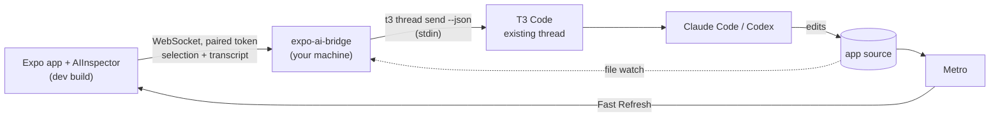

# Expo AI Tools

Point at something in your running Expo app, say what should change, and the instruction lands in
your **existing T3 Code thread**. The agent edits the source, and Expo Fast Refresh shows the result
on the phone you are holding.

```
tap the heading  →  "make this 20% smaller and tighten the space under it"  →  T3 thread  →  agent edits ProfileHeader.tsx  →  Fast Refresh
```

- **Visual selection** with real source mapping: component, `file:line:column` of the JSX, component
  stack, text, style, bounds, and an honest confidence level.
- **On-device dictation** (`en-AU` by default). Audio never leaves the phone; only text is sent.
- **No copy-paste, no second session**: the bridge delivers through T3 Code's own `t3` CLI into the
  thread you choose. The thread remains the source of truth.
- **Status you can trust**: delivered → agent working → files changed → refresh observed on the
  device (or refresh failed / native rebuild required).
- **Development only**: nothing renders, and nothing is instrumented, in production builds.

## How it fits together



| Package                                                                    | What it is                                                               |
| -------------------------------------------------------------------------- | ------------------------------------------------------------------------ |
| [`@dave-morgan/expo-ai-inspector`](packages/expo-ai-inspector)             | React Native overlay + Expo config plugin + Babel entry                  |
| [`@dave-morgan/expo-ai-inspector-transform`](packages/inspector-transform) | Dev-only Babel plugin tagging JSX with source locations                  |
| [`@dave-morgan/expo-ai-bridge`](packages/expo-ai-bridge)                   | Node server/CLI: pairing, queueing, prompt building, T3 delivery, status |
| [`@dave-morgan/expo-ai-t3-adapter`](packages/t3-adapter)                   | `AgentAdapter` interface + T3 CLI implementation                         |
| [`@dave-morgan/expo-ai-protocol`](packages/protocol)                       | Versioned zod schemas shared by phone and bridge                         |
| [`apps/example-expo`](apps/example-expo)                                   | Example app: profile, settings form, cards, design system                |

## Quick start

Requirements: Expo SDK 58 / React Native 0.88 (New Architecture), a development build, Node 20.19+,
T3 Code 0.1.9+ desktop app. Details in [docs/setup.md](docs/setup.md).

```sh
# in your Expo app
npx expo install @dave-morgan/expo-ai-inspector expo-speech-recognition react-native-view-shot expo-secure-store expo-dev-client
```

```js
// babel.config.js
module.exports = (api) => {
  api.cache(true);
  return { presets: ["babel-preset-expo"], plugins: ["@dave-morgan/expo-ai-inspector/babel"] };
};
```

```json
// app.json
{ "expo": { "plugins": ["@dave-morgan/expo-ai-inspector"] } }
```

```tsx
// app/_layout.tsx
import { AIInspector } from "@dave-morgan/expo-ai-inspector";

export default function RootLayout() {
  return (
    <>
      <Stack />
      {__DEV__ && <AIInspector />}
    </>
  );
}
```

```sh
npx expo run:ios            # or run:android: rebuild the dev client once
npm install --save-dev @dave-morgan/expo-ai-bridge
npx expo-ai-bridge doctor   # T3 CLI found? server reachable? threads?
npx expo-ai-bridge start    # prints a 6-digit pairing code (use --lan for phones on Wi-Fi)
```

Bridge config (`expo-ai-bridge.config.json`):

```json
{ "projects": [{ "id": "<your expo slug>", "name": "My app", "root": ".", "t3Project": "." }] }
```

Then in the app: pull down from the thin top indicator to **Pair** and choose your T3 thread.
Tap the indicator to toggle selection, tap an element, then hold the indicator to dictate.
Release to review and **Send to agent**. Turn selection off to use the app normally.

## Working in this repository

```sh
npx -y pnpm@10.34.9 install
npx -y pnpm@10.34.9 build        # all packages
npx -y pnpm@10.34.9 test         # all unit + integration tests
npx -y pnpm@10.34.9 typecheck
```

Running the example on Android/iOS: [docs/setup.md#running-the-example-app](docs/setup.md#running-the-example-app).

## Documentation

- [Architecture](docs/architecture.md), including how to add another coding-agent adapter
- [Setup and troubleshooting](docs/setup.md)
- [Add to an existing app](docs/existing-app.md): install, peer dependencies, Babel, Metro, mount point
- [Physical Android over USB](docs/physical-android.md): `adb reverse`, Metro ports, proxies, dictation models
- [T3 Code integration](docs/t3-integration.md): verified CLI contract, run tracking, queue/steer
- [Component inspection and source mapping](docs/component-inspection.md), including private APIs used
- [Security](docs/security.md)
- [Limitations and validation status](docs/limitations.md)

## Security in one paragraph

The bridge binds to `127.0.0.1` by default, requires a short-lived pairing code to issue a
project-scoped token, validates and size-limits every frame, never executes shell commands from
requests, passes instructions to T3 on stdin, and never stores credentials on the phone. Do not
expose it to the internet. See [docs/security.md](docs/security.md).

## License

MIT
