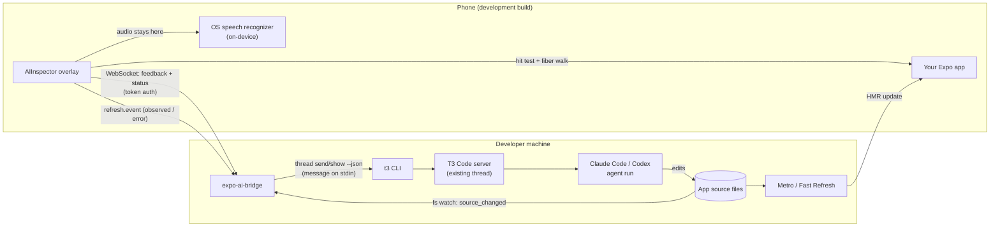
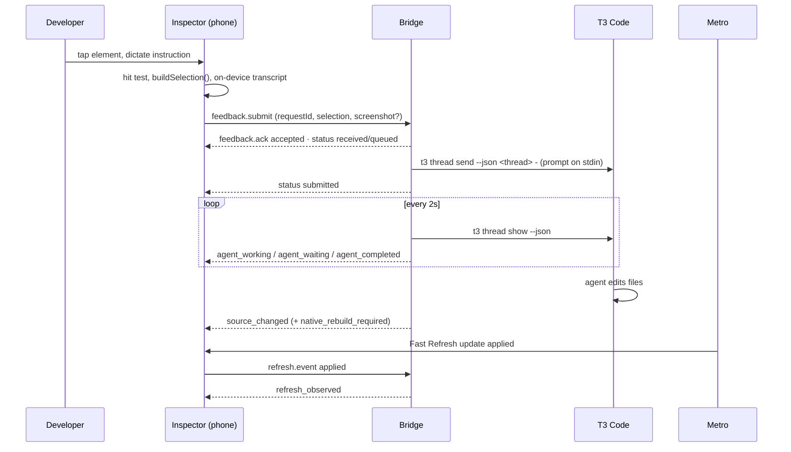

# Architecture

Expo AI Tools has three runtime parts and two build-time helpers:

| Package | Runs on | Role |
| --- | --- | --- |
| `@dave-morgan/expo-ai-inspector` | Phone / simulator (dev builds only) | Overlay: select an element, collect metadata, dictate on-device, submit, show status |
| `@dave-morgan/expo-ai-inspector-transform` (`@dave-morgan/expo-ai-inspector/babel`) | Metro (build time, dev only) | Tags every app JSX element with `__aiSource="file:line:col"` |
| `expo-ai-bridge` | Developer machine | Pairing, authenticated WebSocket, queueing, prompt building, T3 delivery, run/refresh tracking |
| `@dave-morgan/expo-ai-t3-adapter` | Developer machine (inside the bridge) | Talks to T3 Code through its public `t3` CLI |
| `@dave-morgan/expo-ai-protocol` | Both sides | Versioned zod schemas for every frame |



## Request lifecycle



Phases are not strictly ordered: the agent usually edits files, and Fast Refresh usually applies, while
its run is still "working". The inspector therefore tracks every phase it has seen and shows four
independent steps: delivered, agent, files changed, refreshed.

## Design decisions

- **T3 via its CLI, not its internals.** T3 Code 0.1.9 ships `t3 thread list|show|send --json`, a
  supported surface that talks to the running server with the local owner's credentials. The bridge
  never reads T3's SQLite state, never patches T3 and never starts its own agent session. See
  [t3-integration.md](./t3-integration.md).
- **Source locations from a Babel transform.** React 19 no longer records `_debugSource`, so the
  inspector cannot rely on React for file/line. A tiny dev-only transform adds a string prop at each
  JSX call site, which React keeps on the fiber. See [component-inspection.md](./component-inspection.md).
- **Native hit testing.** On the New Architecture the inspector asks Fabric's `findNodeAtPoint` (the
  same primitive React Native's own inspector uses), so transforms, `pointerEvents`, overflow and
  z-order are handled natively. Web uses `document.elementsFromPoint`; a geometric fallback exists.
- **Speech on the device.** `expo-speech-recognition` with `requiresOnDeviceRecognition: true`. Only
  text crosses the network. If on-device recognition is impossible, the UI offers typed input; it
  never silently switches to a cloud recognizer.
- **No custom hot reload.** Metro's file watcher and Fast Refresh do the work; the bridge only
  observes file changes and the inspector only observes Fast Refresh.
- **Everything dev-only.** `AIInspector` returns `null` unless `__DEV__`; the transform is a no-op
  when Metro reports a production build; the config plugin only adds permission strings.

## Adding another coding-agent adapter

The bridge depends only on the `AgentAdapter` interface from `@dave-morgan/expo-ai-t3-adapter`
(`packages/t3-adapter/src/agent-adapter.ts`):

```ts
interface AgentAdapter {
  readonly id: string;
  capabilities(): AdapterCapabilities;          // queue / steer / attachments / runStatus / listThreads
  diagnose(): Promise<DiagnosticReport>;        // actionable checks for `expo-ai-bridge doctor`
  listThreads(projectRef: string): Promise<AgentThread[]>;
  getThread(threadId: string): Promise<AgentThreadState>;
  sendMessage(input: { threadId; message; mode }): Promise<SendResult>;
  classifyRun(state: AgentThreadState, runId: string | null): RunPhase;
}
```

To add one (for example a Codex CLI or a hosted agent API):

1. Implement the interface in a new package. Throw `AdapterUnavailableError` when the agent cannot
   be reached (the bridge keeps the request queued and retries), `ThreadNotFoundError` for unknown
   threads, `AdapterProtocolError` for unparseable output.
2. Report capabilities honestly. If `steer` is `false` the bridge downgrades `steer`/`auto` to queue
   and tells the developer.
3. Never spawn shells with user text. Pass messages through stdin or an API body.
4. Inject it: `createBridge(config, { adapter: new MyAdapter() })`, or add a `--adapter` option to
   the CLI.
5. Reuse the integration-test pattern in `packages/t3-adapter/test/fixtures/fake-t3.mjs`: a fake
   executable with a JSON state file lets the full bridge be tested end to end without the agent.
